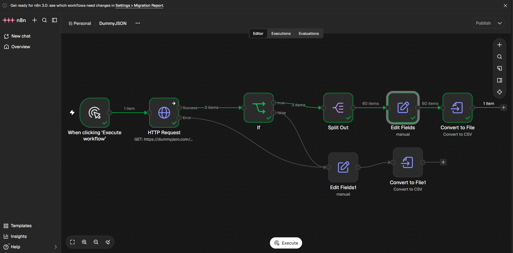
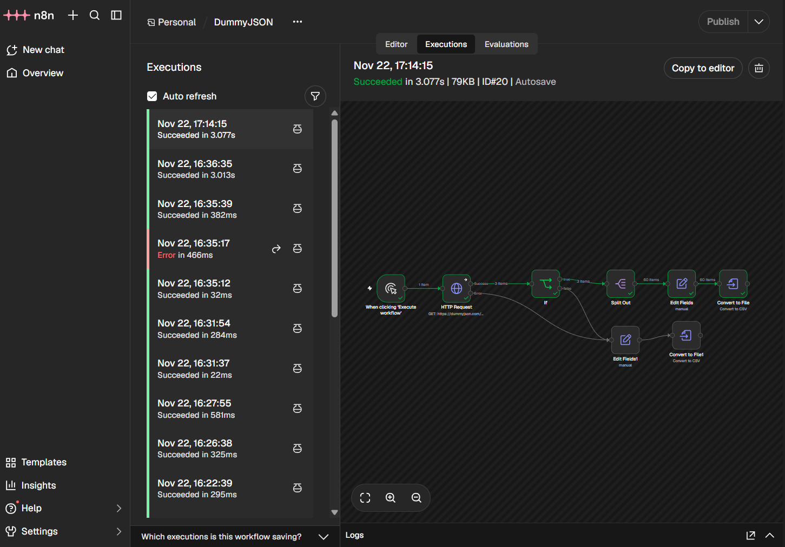

# Лабораторная работа № 3

**Сбор данных через REST API: Python и n8n. Вариант 4**  

## 1. Цель работы и источники

Цель — получить данные через REST API программным и визуальным способами, объединить связанные сущности, проверить качество и сравнить полученные результаты. Для варианта 4 использован DummyJSON: Posts и Comments — основные ресурсы, Users — источник сведений об авторах постов.

| Поле паспорта API | Значение |
| --- | --- |
| Базовый URL | `https://dummyjson.com` |
| Эндпоинты | `GET /posts`, `GET /comments`, `GET /users` |
| Аутентификация | Для использованных запросов не требуется |
| Формат | JSON, списки в полях `posts`, `comments`, `users` |
| Пагинация | `limit` — размер страницы, `skip` — смещение; API также возвращает `total` |
| Ключи | `posts.id`, `comments.id`, `users.id` |
| Связи | `posts.userId = users.id`; `comments.postId = posts.id` |
| Лимиты | Числовая квота в использованных разделах документации не указана; заголовки лимитов в Python-журнале не сохраняются |
| Даты | У используемых постов и комментариев нет даты публикации; дата запуска присутствует в имени файла журнала |

## 2. Программная реализация

Схема обработки: **API → постраничный сбор → JSONL → DataFrame → объединение постов, авторов и комментариев → проверки → CSV и state.json**.

Создана сессия `requests.Session` с заголовками User-Agent и Accept. Функция `get_data` выполняет GET с timeout 20 секунд, проверяет HTTP-статус и Content-Type. При ошибке формируется сообщение с URL и первыми 200 байтами ответа. В журнал записываются URL, страница, статус, число записей и время запроса. Исключение перехватывается в `collect`, выводится сообщение об ошибке; автоматические повторы в текущем коде отсутствуют.

Функция `collect` принимает размер страницы и ограничения по числу записей и страниц. `skip` равен числу уже полученных записей. Сбор завершается при пустом ответе либо достижении ограничения; значение `total` не используется. Сырые сущности сохраняются построчно в `raw_posts.jsonl`, `raw_comments.jsonl`, `raw_users.jsonl`.

Вложенные объекты преобразуются через `pd.json_normalize(..., sep='_')`. Из Users выбираются ID, имя, фамилия, username и email. Левое соединение постов с авторами сохраняет число постов. Затем выполняется левое соединение с комментариями: пост с несколькими комментариями занимает несколько строк, пост без комментариев сохраняется с пустыми полями комментария.

### Результаты чистого прогона

Перед запуском папка `results` была очищена. В отчёте используются только результаты нового чистого прогона Python:

| Показатель | Результат |
| --- | ---: |
| Постов | 60 |
| Загружено пользователей | 208 |
| Загружено комментариев | 340 |
| Строк после объединения | 103 |

Результат находится в `results/res_data.csv.

## 3. Качество данных и инкрементальность

В Notebook числовые столбцы приводятся через `pd.to_numeric`. Рассчитывается полнота полей и проверяется неотрицательность лайков и дизлайков постов. Обе проверки проходят.

| Метрика | Результат: 103 строки |
| --- | ---: |
| Полнота полей поста и автора | 100% |
| Полнота каждого поля комментария | 85,4% |
| Строк без комментария | 15 |

Повторы postId объясняются связью «один пост — много комментариев» и не являются полными дублями.

В чистом прогоне начальное значение водяного знака равно 0. Сохранены все 103 строки по 60 постам, после чего `state.json` содержит `last_post_id: 60`. При последующем выполнении выбираются строки с большим postId.

## 4. No-code реализация в n8n

 Экспорт схемы сохранён в `no_code/DummyJSON.json`, результат — в `no_code/nocode_result.csv`.

**Manual Trigger → HTTP Request → IF → Split Out → Edit Fields → Convert to File.**

HTTP Request получает `/posts` с limit=20. Пагинация меняет skip выражением `$pageCount * 20`, ограничена тремя страницами, между запросами задана пауза 1000 мс. Timeout — 20000 мс. Условие завершения учитывает HTTP-ошибку, пустой список и достижение total. Включены полный ответ и Never Error, поэтому узел IF явно проверяет `statusCode == 200`. Такой способ настроен после проверки поведения ошибки при включённой пагинации. Настройки ответа и пагинации описаны в HTTP Request.

При успехе Split Out разворачивает `body.posts` в отдельные элементы. Edit Fields формирует пять столбцов: post_id, title, body_preview, author_id, reactions_total. Выполняются три преобразования: удаление крайних пробелов названия, сокращение текста до 120 символов, сложение лайков и дизлайков. Convert to File создаёт CSV.

Выход IF false и отдельный выход ошибки HTTP Request соединены с веткой `Edit Fields1 → Convert to File1`, предназначенной для формирования `nocode_error.csv`.

Рисунок 1. Схема и успешное выполнение workflow. На выходе HTTP Request — 3 элемента, после Split Out — 60, после Convert to File — один файл.

Рисунок 2. Запуск № 20 от 22 ноября 2026 года, 17:14:15 по отображению интерфейса n8n. Статус — Succeeded, полная длительность — **3,077 с**. На схеме этого запуска подтверждены три ответа API и обработка 60 постов.

В экспортированном CSV 60 строк и 5 полей, пропусков и дублей post_id нет. Все 60 ID совпадают с текущей Python-выборкой. Проверка title, body_preview, author_id и reactions_total по сырым постам Python не выявила расхождений.

## 5. Сравнение подходов

| Критерий | Python | n8n |
| --- | --- | --- |
| Объём | 103 строки по 60 постам после обогащения | 60 постов, 60 строк |
| Источники | Posts, Users, Comments | Posts |
| Пагинация | Цикл с limit/skip и ограничениями | Встроенная|
| Проверки ошибок | Статус, Content-Type, сообщение в журнале; повторов нет | IF по статусу и отдельная ветка ошибки |
| Воспроизводимость | Notebook, JSONL, CSV, состояние | Экспорт workflow JSON и CSV |
| Полное время прогона, с | 2,64 с | 3,077 |
| Стоимость 100 локальных прогонов | 0 | 0 |
| Порог входа, 1–5 | 2 | 3 |

Python удобен для связанных таблиц, проверок и состояния. n8n делает маршрут обработки наглядным и позволяет собрать небольшую выгрузку узлами. Для регулярной задачи подходит гибрид: Python выполняет сбор и проверки, n8n запускает процесс и организует уведомления.

## 6. Правовые аспекты и границы выполнения

DummyJSON — учебный источник фиктивных данных. Использованы публичные GET-запросы, секреты для них не требуются. Выгрузка Users содержит полные синтетические профили, включая дополнительные поля, которые не вошли в итоговую таблицу.
